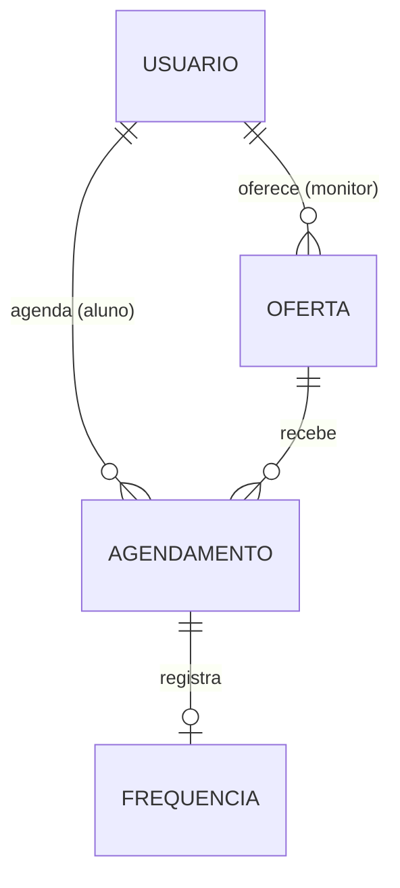
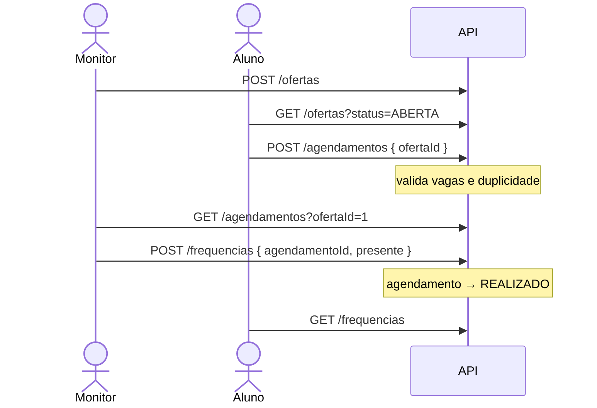

# Contrato da API

**Status:** rascunho para discussão da equipe.

Contrato entre frontend e backend. Qualquer mudança aqui deve ser combinada com a
equipe e feita no mesmo PR que altera a implementação.

Decisões relacionadas: [ADR-0002 — Persistência](adr/0002-persistencia-sqlite-prisma.md) ·
[ADR-0003 — Identificação](adr/0003-identificacao-simplificada.md)

## Convenções gerais

- Base local: `http://localhost:3000`
- Corpo das requisições e respostas em **JSON**.
- Datas em **ISO 8601 UTC** (`2026-11-20T14:00:00.000Z`).
- IDs são inteiros.
- Rotas que dependem do usuário exigem o cabeçalho **`X-Usuario-Id`** (ver ADR-0003).
  Na tabela de cada rota, a coluna **Quem** indica o papel exigido.

### Erros

Todas as respostas de erro seguem o formato:

```json
{ "erro": { "codigo": "OFERTA_SEM_VAGAS", "mensagem": "Não há vagas disponíveis nesta oferta." } }
```

| Status | Quando |
|---|---|
| `400` | Corpo ou parâmetros inválidos (campo faltando, tipo errado) |
| `401` | `X-Usuario-Id` ausente ou de usuário inexistente |
| `403` | Usuário não tem o papel ou a permissão para a operação |
| `404` | Recurso não encontrado |
| `409` | Violação de regra de negócio (sem vagas, agendamento duplicado etc.) |

## Modelo de dados



### Usuario

| Campo | Tipo | Observação |
|---|---|---|
| `id` | int | |
| `nome` | string | |
| `email` | string | único |
| `papel` | `ALUNO` \| `MONITOR` | |

### Oferta

Uma sessão de monitoria com data, horário e número de vagas.

| Campo | Tipo | Observação |
|---|---|---|
| `id` | int | |
| `disciplina` | string | ex.: `"Algoritmos e Estruturas de Dados I"` |
| `codigoDisciplina` | string | ex.: `"GCC216"` |
| `descricao` | string? | opcional |
| `local` | string | sala ou link |
| `inicio` | datetime | |
| `fim` | datetime | depois de `inicio` |
| `vagas` | int | ≥ 1 |
| `vagasDisponiveis` | int | **calculado**: `vagas` − agendamentos ativos |
| `status` | `ABERTA` \| `ENCERRADA` | |
| `monitor` | `{ id, nome }` | |

### Agendamento

| Campo | Tipo | Observação |
|---|---|---|
| `id` | int | |
| `ofertaId` | int | |
| `alunoId` | int | |
| `status` | `AGENDADO` \| `CANCELADO` \| `REALIZADO` | |
| `criadoEm` | datetime | |

### Frequencia

| Campo | Tipo | Observação |
|---|---|---|
| `id` | int | |
| `agendamentoId` | int | único (uma frequência por agendamento) |
| `presente` | boolean | |
| `observacao` | string? | opcional |
| `registradoEm` | datetime | |

## Endpoints

### Saúde

| Método | Rota | Quem | Descrição |
|---|---|---|---|
| `GET` | `/health` | — | Verifica se a API está no ar |

### Usuários

| Método | Rota | Quem | Descrição |
|---|---|---|---|
| `POST` | `/usuarios` | — | Cadastra usuário |
| `GET` | `/usuarios` | — | Lista usuários (`?papel=MONITOR`) — usado na tela "entrar como" |
| `GET` | `/usuarios/:id` | — | Detalha um usuário |

`POST /usuarios`

```json
{ "nome": "Ana Souza", "email": "ana@estudante.ufla.br", "papel": "ALUNO" }
```

→ `201` com o usuário criado · `409 EMAIL_JA_CADASTRADO`

### Ofertas

| Método | Rota | Quem | Descrição |
|---|---|---|---|
| `GET` | `/ofertas` | — | Lista ofertas. Filtros: `?status=ABERTA`, `?codigoDisciplina=GCC216`, `?monitorId=2` |
| `GET` | `/ofertas/:id` | — | Detalha uma oferta (com `vagasDisponiveis`) |
| `POST` | `/ofertas` | MONITOR | Cria oferta; o monitor é o usuário do cabeçalho |
| `PATCH` | `/ofertas/:id` | MONITOR dono | Altera campos ou encerra (`{ "status": "ENCERRADA" }`) |

`POST /ofertas`

```json
{
  "disciplina": "Algoritmos e Estruturas de Dados I",
  "codigoDisciplina": "GCC216",
  "descricao": "Revisão para a prova 2",
  "local": "DCC - Sala 105",
  "inicio": "2026-11-20T14:00:00.000Z",
  "fim": "2026-11-20T16:00:00.000Z",
  "vagas": 10
}
```

→ `201` com a oferta criada

Regras:
- `fim` deve ser depois de `inicio`, e `inicio` deve estar no futuro (`400`).
- `vagas` não pode ficar menor que o número de agendamentos ativos (`409 VAGAS_INSUFICIENTES`).
- Só o monitor que criou a oferta pode alterá-la (`403`).

### Agendamentos

| Método | Rota | Quem | Descrição |
|---|---|---|---|
| `POST` | `/agendamentos` | ALUNO | Agenda o aluno do cabeçalho numa oferta |
| `GET` | `/agendamentos` | ALUNO / MONITOR | Aluno: os seus. Monitor: filtra por `?ofertaId=` das suas ofertas |
| `PATCH` | `/agendamentos/:id/cancelar` | ALUNO dono | Cancela o agendamento |

`POST /agendamentos`

```json
{ "ofertaId": 1 }
```

→ `201` com o agendamento criado

Regras:
- Oferta precisa existir (`404`), estar `ABERTA` e não ter começado (`409 OFERTA_INDISPONIVEL`).
- Precisa ter vaga (`409 OFERTA_SEM_VAGAS`).
- O aluno não pode ter outro agendamento ativo na mesma oferta (`409 AGENDAMENTO_DUPLICADO`).
- Cancelar só é permitido com status `AGENDADO` e antes do `inicio` da oferta (`409`).
  O cancelamento libera a vaga.

### Frequências

| Método | Rota | Quem | Descrição |
|---|---|---|---|
| `POST` | `/frequencias` | MONITOR da oferta | Registra presença ou falta de um agendamento |
| `GET` | `/frequencias` | ALUNO / MONITOR | Aluno: o seu histórico. Monitor: `?ofertaId=` de uma oferta sua |

`POST /frequencias`

```json
{ "agendamentoId": 7, "presente": true, "observacao": "Tirou dúvidas sobre árvores AVL" }
```

→ `201` com a frequência criada

Regras:
- Só o monitor da oferta do agendamento pode registrar (`403`).
- Só depois do `inicio` da oferta (`409 SESSAO_NAO_INICIADA`).
- O agendamento precisa estar `AGENDADO` (`409`); ao registrar, passa para `REALIZADO`.
- Uma frequência por agendamento (`409 FREQUENCIA_JA_REGISTRADA`).

## Fluxo principal (transação entre contextos)



## Pontos em aberto

- Oferta recorrente (ex.: toda terça às 14h) ou só sessões avulsas? Este rascunho usa sessões avulsas.
- O aluno pode ver quem mais está agendado na oferta?
- Precisamos de exclusão de oferta, ou encerrar já é suficiente?
